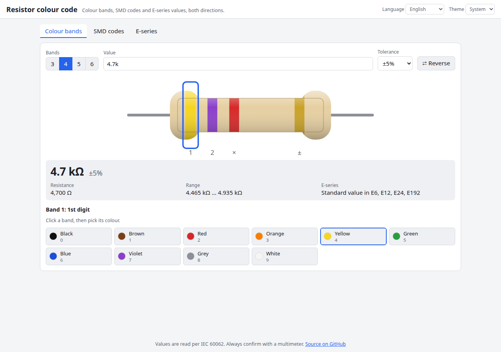

# Resistor Colour Code

Click the bands or type a value, and read a resistor in both directions. It handles 3, 4, 5 and 6 band resistors, SMD markings (3/4-digit, R notation, EIA-96) and the preferred-number series E6 to E192, with an interactive drawing of the resistor.

**Try it: [hermes98761234.github.io/resistor-color-code](https://hermes98761234.github.io/resistor-color-code/)**

[](https://github.com/hermes98761234/resistor-color-code/actions/workflows/deploy.yml)



## Features

- **Bands to value and value to bands.** Click a band in the drawing and pick a colour, or type `4.7k`, `4k7`, `4R7`, `2M2` and the bands follow. Switching between 3, 4, 5 and 6 bands keeps the value.
- **Full colour code.** Digits, multipliers (including gold and silver), tolerance (±0.05% to ±10%) and the temperature coefficient of 6-band parts, plus the tolerance range and a note when a value is not exactly representable with that many bands.
- **Reverse button** for when you read the resistor from the wrong end.
- **SMD codes in both directions:** 3-digit (`472`), 4-digit (`1002`), R notation (`4R7`, `R47`) and EIA-96 (`01C`, `68X`), with every exact marking shown for a value.
- **E-series picker** for E6, E12, E24, E48, E96 and E192: browse any decade, click a value to see its bands, or find the nearest standard value, its neighbours and the error in each series.
- **English or Ukrainian, light, dark or system theme.** Your settings and last inputs are remembered in the browser. No backend, no tracking.

## How it works

Digit bands give the significant figures (two for 3 and 4 bands, three for 5 and 6 bands). The next band is the multiplier, 10 to the power of the colour's number, with gold for 0.1 and silver for 0.01. After that come the tolerance and, on 6-band resistors, the temperature coefficient (IEC 60062).

E24 and below use the published tables. E48, E96 and E192 are `10^(i/N)` rounded to three significant digits, which reproduces the standard IEC 60063 values. SMD EIA-96 codes map two digits to the 96 E96 values (100 to 976) and a letter to the multiplier. The logic lives in `src/lib/` as pure functions covered by unit tests.

## Quick start

You need [Node.js](https://nodejs.org/) 22.

```bash
git clone https://github.com/hermes98761234/resistor-color-code.git
cd resistor-color-code
npm install
npm run dev       # http://localhost:5173
npm test          # colour code, SMD, E-series, state and i18n tests
npm run build     # static site in dist/
```

## License

MIT
